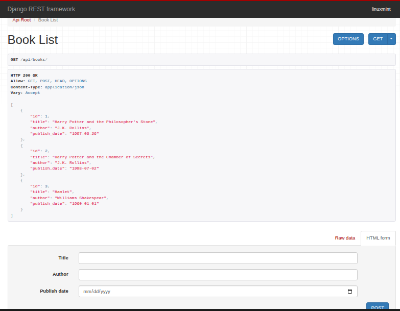

# Django API - Books List

### Fields Include
> Book title
>  Book Publisher
>  Book Release Date

### to build via Docker:
> docker build -t books_app .
>  docker run -p 8002:8002 books_app:latest
 -- on web browser, run: http://127.0.0.1:8002/api

### App's architectural details are availbale on the Architecture.MD file

### App's active URL:
>  https://books-api-v1-x1p5.onrender.com/api/books/

